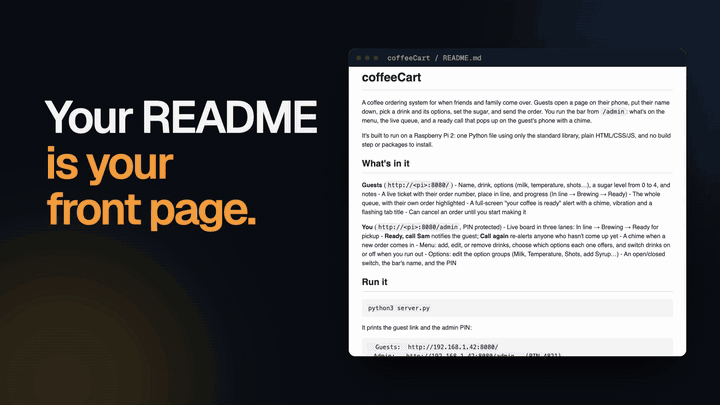
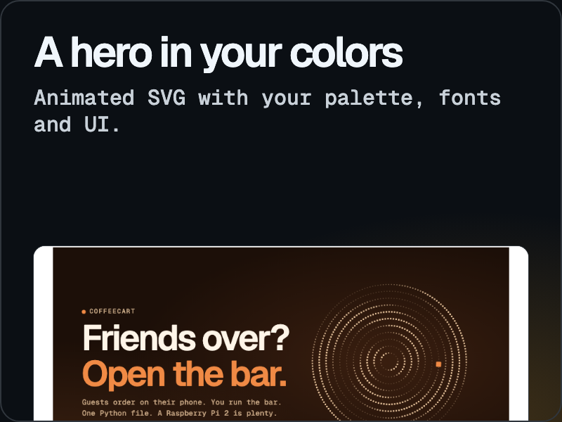
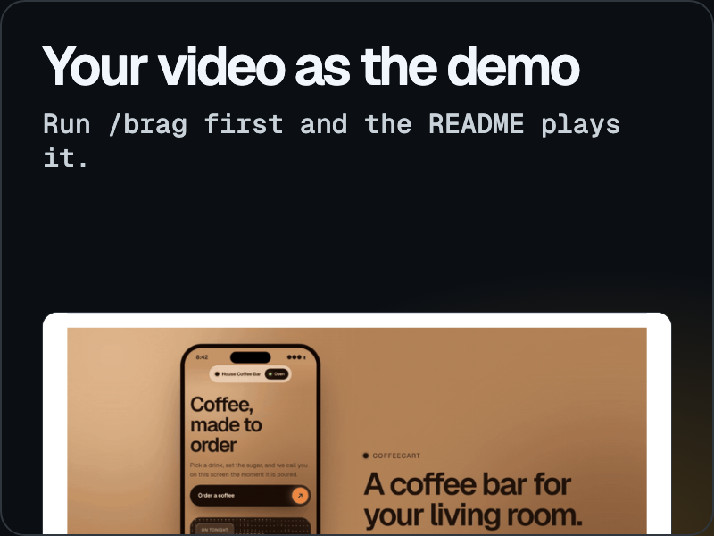
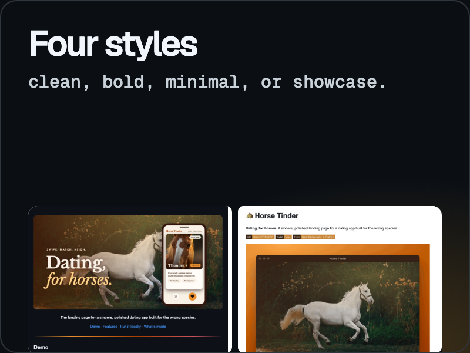
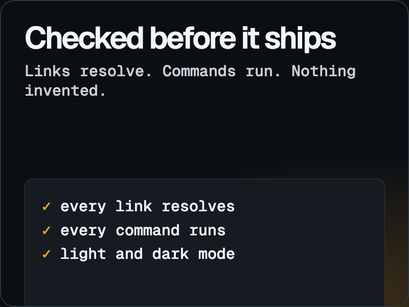
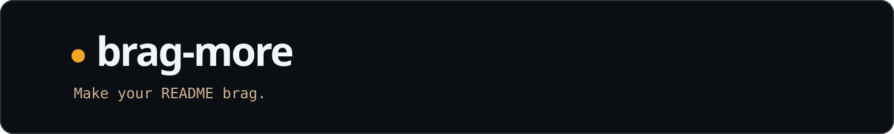

<a id="readme-top"></a>

<p align="center">
  <a href="#demo"></a>
</p>

<p align="center">
  <strong>An agent skill that rebuilds your GitHub README into a front page worth landing on.</strong><br>
  Animated hero in your project's colors, a framed demo, feature cards, honest badges, a quickstart that runs.
</p>

<p align="center">
  
</p>

<p align="center">
  <a href="#demo">Demo</a> ·
  <a href="#features">Features</a> ·
  <a href="#use-it">Use it</a> ·
  <a href="#install">Install</a> ·
  <a href="#credits">Credits</a>
</p>


## Demo

<p align="center">
  <a href="brag-output/brag.mp4"></a>
  <br>
  <sub>▶ Click for the full 22-second video with sound. It was made with <a href="https://github.com/latent-spaces/brag">brag</a>, and the README you're reading was made by brag-more.</sub>
</p>

## Features

<p align="center">
  
  
  
  
</p>


## Use it

```text
/brag-more
/brag-more --style bold
/brag-more --style showcase
/brag-more --preview
```

| Style | Feel |
|---|---|
| `clean` | Animated hero, framed demo, tidy cards. The default. |
| `bold` | Full-bleed hero in brand colors, punchy one-liner. |
| `minimal` | Small animated logo lockup and plain sections. |
| `showcase` | Dense, emoji-sectioned, screenshot-first. Good for hackathon, research and ML projects. |

Your existing README text is kept and restyled. Nothing is committed or pushed. With `--preview` it writes to `brag-output/repo/` and leaves `README.md` alone.

If you ran `/brag` first, the README uses your launch video as its demo. brag-more is a companion to [brag](https://github.com/latent-spaces/brag), which makes the video.

## Install

```bash
npx skills add https://github.com/omer-chandna/brag-more --skill brag-more
```

Or copy it by hand:

```bash
rsync -a skills/brag-more/ ~/.claude/skills/brag-more/
```

Restart your agent after copying.

> [!NOTE]
> The animated hero only plays on GitHub itself. Elsewhere you'll see its first frame.

## What's here

| Path | What it is |
|---|---|
| `skills/brag-more/SKILL.md` | The skill |
| `brag-output/` | This repo's own launch video, plan and share copy |
| `.github/readme/` | The images this README uses, made by the skill |

<p align="center">
  
</p>

## Credits

Built on [brag](https://github.com/latent-spaces/brag) by Shunit Haviv Hakimi (MIT). See [LICENSE](LICENSE).

<p align="right"><a href="#readme-top">↑ back to top</a></p>
